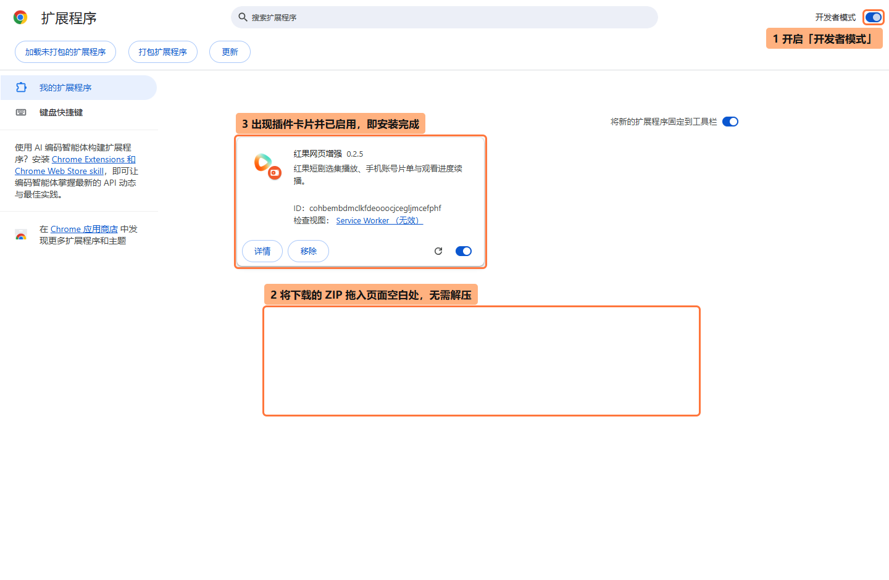
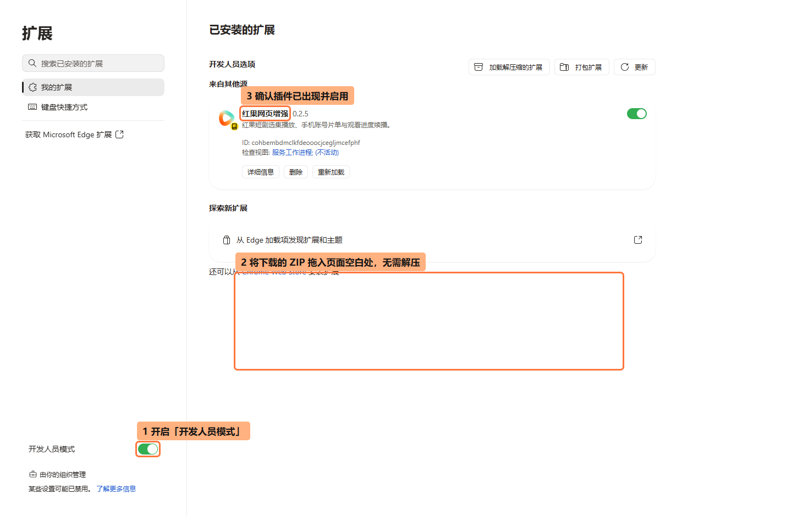

# 红果网页增强 0.2.6 安装说明

[插件下载](https://github.com/ILikeVideo/HongGuoTV-Web/releases) · [网页完整图文教程](https://hongguotv.curatedlifefinds.com/web-extension/install/)

Chrome：开发者模式位于管理页右上角。Edge：开发人员模式位于左下角。开启后，直接将 ZIP 从文件管理器拖入扩展管理页空白处，**无需解压**。内部地址需要复制到浏览器地址栏，不能从普通网页直接打开。

以上为中文界面真实截图，橙框为操作标注。下载 Releases 中的 `hongguo-web-版本号.zip`，保持原样，不要选择 GitHub 的 Source code。组织策略禁止加载时请联系管理员。

推荐使用电脑上的 Chrome 或 Edge。UC、360、QQ、星愿等浏览器，可从菜单进入“扩展管理”或“应用中心”，开启开发者模式后拖入 ZIP；若浏览器不接收 ZIP，可解压后加载目录。

1. 下载 `hongguo-web-0.2.6.zip`，无需解压。
2. Chrome 打开 `chrome://extensions/`；Edge 打开 `edge://extensions/`。
3. 开启“开发者模式”，把 ZIP 拖入扩展管理页内容区，按浏览器提示确认。
4. 刷新 `https://hongguoduanju.com/`，顶部“榜单”与“下载”之间出现“我的”。

播放保持官网熟悉的页面、选集区和控制栏。可以直接选集，使用暂停、进度、音量、倍速和全屏等操作。

“我的”提供历史、收藏、点赞和预约。所有登录、验证码及退出均使用官网右上角入口，插件不提供登录表单。官网登录成功后，插件关联本机设备和手机号；已经登录时读取官网提供的号码，只有脱敏值时保留脱敏值。插件仅读取片单和云端进度，不主动修改历史、收藏、点赞或预约；官网自身行为由官网控制。

账号关联资料保存在当前浏览器中，不云同步、不发送给红果TV后台。退出官网后清除当前关联；卸载扩展会删除本机保存的账号资料。

“我的”为正常布局的顶部 Tab，没有返回按钮，通过顶部栏目或浏览器前后操作切换。封面自动兼容手机端HEIC格式。工具栏使用无文字标志，点击打开 `https://hongguoduanju.com/?tab=feed`；首页电视版按钮、下载右侧“红果TV电视版”Tab 和电视版二维码链接均在新标签页打开电视官网。

鼠标位于视频区域时，滚轮向下切下一集、向上切上一集。浏览推荐时切换上一部／下一部，点选本剧分集后改为切换上下集。侧栏、音量、进度、菜单内的滚动保持原有操作。

部分功能联网后自动更新。需要更新安装包时，下载新版 ZIP 并按下方步骤操作。

从旧版升级：关闭官网标签页，下载新版 ZIP，打开开发者模式后拖入，按浏览器提示完成，确认只启用一个版本后刷新官网。原来使用解压目录安装的用户，可在原目录替换文件并点“重新加载”，保留本机资料。移除扩展会清除本机资料。

如果拖入没有反应，确认开发者模式已开启、没有拖到地址栏。也可以解压 ZIP，点“加载已解压的扩展程序”，选择插件所在文件夹；此方式安装后需保留该文件夹。

播放期间可能显示带“广告”标识的推广卡片，可点击卡片查看，也可点右上角“×”关闭。

需要帮助或有建议，可以在公开仓库反馈问题。
