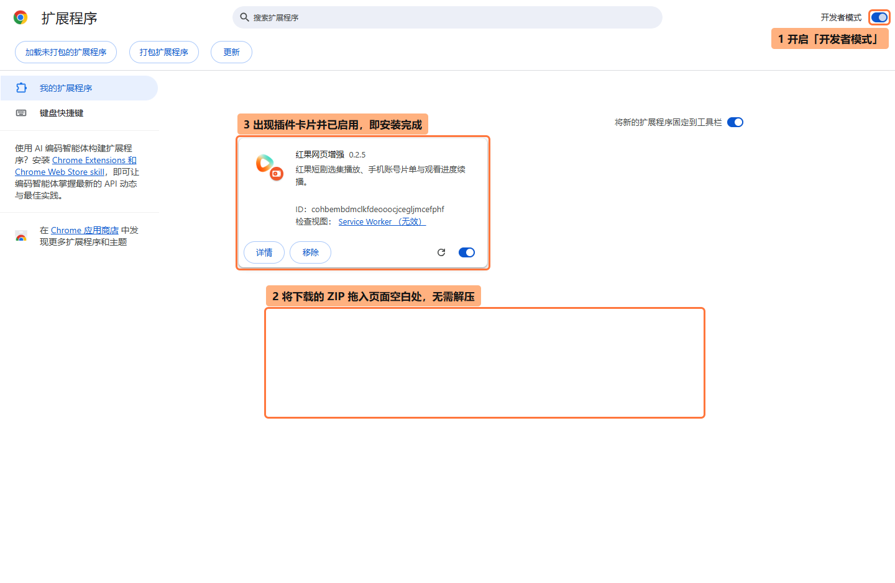
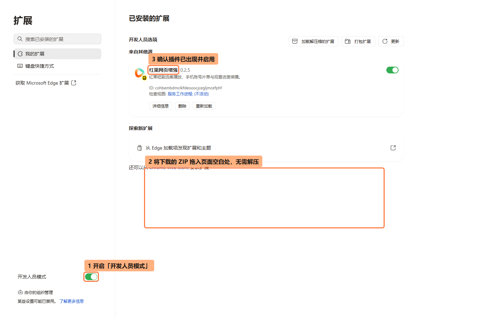

# 红果TV · 网页增强插件

为 [红果短剧官网](https://hongguoduanju.com/) 提供 Chrome、Edge 网页增强，沿用官网原页面、原播放器和原控制栏。

[下载插件](https://github.com/ILikeVideo/HongGuoTV-Web/releases) · [图文安装教程](https://hongguotv.curatedlifefinds.com/web-extension/install/) · [功能介绍](https://hongguotv.curatedlifefinds.com/web-extension/) · [红果TV官网](https://hongguotv.curatedlifefinds.com/)

## 功能

- 推荐页和正剧页提供完整选集入口，保持官网原视频、控制栏和页面布局。
- “榜单”右侧增加“我的”：历史、收藏、点赞、预约；预约分已上线、待上线，支持分页与已有云端进度续播。
- 使用官网登录，不提供独立登录表单；片单仅读取，不主动写回收藏、点赞、预约或历史。
- 提供红果TV官网入口与二维码，方便在电视上观看。
- 日常功能联网更新，安装包可随时从下载页获取新版。

## 安装

请使用**电脑上的最新版 Chrome 或 Edge**。无需开启“允许用户脚本”。

1. 下载 `hongguo-web-版本号.zip`，**保持 ZIP 原样，无需解压**。在 GitHub 下载时，请选择 Assets 中的插件 ZIP。
2. 复制下表地址到对应浏览器的**地址栏**，按回车。
3. 开启开发者模式，将 ZIP 从文件管理器**直接拖入扩展管理页的空白区域**，按浏览器提示确认。
4. 确认插件已启用，刷新红果官网；顶部“榜单”右侧、“下载”左侧出现“我的”。

| 浏览器 | 扩展管理页地址 | 开关位置 | 安装动作 |
| --- | --- | --- | --- |
| Google Chrome | `chrome://extensions/` | 右上角“开发者模式” | 拖入 ZIP |
| Microsoft Edge | `edge://extensions/` | 左下角“开发人员模式” | 拖入 ZIP |

内部地址不能从普通网页直接打开，请复制到地址栏；不要粘贴到搜索框。组织管理的浏览器可能禁止加载，请联系管理员。

截图为 Chrome 157、Edge 155 中文管理页的真实截图，橙框是操作标注。浏览器版本不同，菜单名称和位置可能变化。

[Chrome 官方下载](https://www.google.com/chrome/) · [Chrome 官方安装说明](https://developer.chrome.com/docs/extensions/get-started/tutorial/hello-world#load-unpacked) · [Edge 官方下载](https://www.microsoft.com/edge/download) · [Edge 官方安装说明](https://learn.microsoft.com/microsoft-edge/extensions/getting-started/extension-sideloading)

## 更新与使用

ZIP 更新：关闭红果官网标签页，下载新版 ZIP，打开开发者模式后拖入，按浏览器提示完成。确认只启用一个版本，再刷新官网。若原来采用解压目录安装，可在原固定目录替换文件后点击“重新加载”，保留本机资料；不要先卸载。

部分功能联网后自动更新。需要更新安装包时，下载新版 ZIP 后按上方步骤安装即可。

账号登录、验证码、退出与换号均在官网完成。关联资料与会话保存在本机扩展存储，不云同步、不上传红果TV后台；官网退出后清除当前关联。请勿在反馈中提交手机号、验证码、Cookie、密钥或完整播放地址。

- **拖入 ZIP 没反应：**确认已开启开发者模式，拖到扩展管理页内容区，而非地址栏。兼容方法：解压 ZIP，点击“加载已解压的扩展程序”，选择直接包含 `manifest.json` 的目录。
- **官网没有“我的”：**确认插件已启用、允许访问官网，重新加载后刷新标签页。
- **卸载：**扩展管理页 → 红果网页增强 → 移除，不会删除官网账号或云端片单。

需要帮助或有建议，可以[反馈问题](https://github.com/ILikeVideo/HongGuoTV-Web/issues)。关注[红果TV发布频道](https://t.me/HongGuoTVPublish)，获取新版通知。

本项目遵循 GPL-3.0-only，依赖许可证随包保留，详见 [NOTICE.md](NOTICE.md)。第三方工具，与红果短剧官方无隶属关系，请在合法授权范围内使用。
